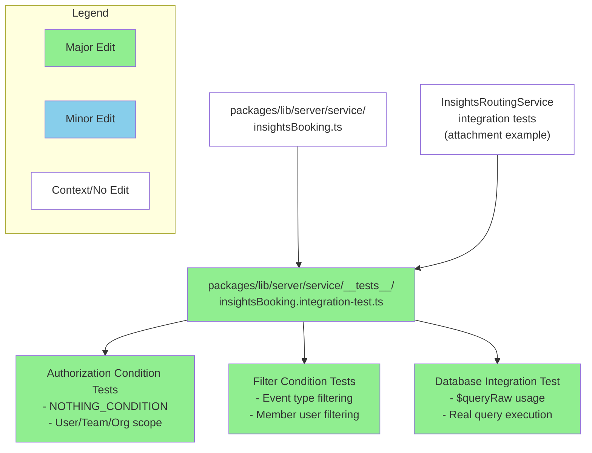

## feat: convert InsightsBookingService to use Prisma.sql raw queries

# Fix: Update InsightsBookingService integration tests for Prisma.sql format

## Summary

This PR updates the `InsightsBookingService` integration tests to work with the new Prisma.sql format that was previously converted in the service implementation. The changes follow the exact same testing patterns established in the `InsightsRoutingService` integration tests.

**Key Changes:**
- Replace Prisma object notation expectations with direct `Prisma.sql` template literal comparisons
- Add `NOTHING_CONDITION = Prisma.sql`1=0`` constant for consistency with other services
- Update all authorization and filter condition tests to expect raw SQL instead of object structures
- Modify the final integration test to use `$queryRaw` for actual database querying
- Remove complex object notation assertions in favor of direct SQL comparisons

## Review & Testing Checklist for Human

⚠️ **HIGH RISK** - This involves SQL query construction and authorization logic

- [ ] **Run integration tests manually** - I encountered test runner configuration issues, so please verify the tests actually pass: `TZ=UTC yarn test packages/lib/server/service/__tests__/insightsBooking.integration-test.ts`
- [ ] **Review SQL query construction** - Carefully examine the authorization conditions in the service, especially complex team/org scope logic with AND/OR combinations
- [ ] **Verify authorization security** - Test with different user roles (owner, admin, member) to ensure no privilege escalation bugs
- [ ] **Check parameter binding** - Ensure all user inputs in the SQL templates are properly parameterized (no injection risks)
- [ ] **Test edge cases** - Verify behavior with empty teams, missing users, null values, and boundary conditions

**Recommended Test Plan:**
1. Run the integration tests locally to verify they pass
2. Test the service with various user roles and team configurations
3. Verify the `$queryRaw` integration test actually queries the database correctly
4. Check that authorization conditions properly restrict access based on user permissions

---

### Diagram

### Notes

- This conversion was based on the InsightsRoutingService integration test patterns provided in the user's attachment
- The test runner had configuration issues during development, so manual verification of test execution is critical
- All test expectations now use direct `Prisma.sql` comparisons instead of inspecting `.strings` and `.values` properties
- The NOTHING_CONDITION constant ensures consistency across different insight services

**Session Info:** Requested by @eunjae-lee | Session: https://app.devin.ai/sessions/a5e216ec6c364679a220f799e2abc700
